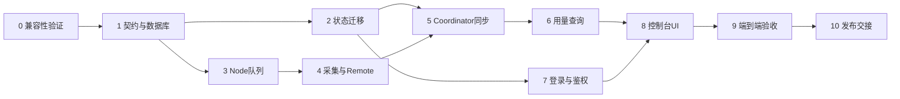

# Coordinator 管理登录、统一 SQLite 与节点用量 Implementation Plan

> **For agentic workers:** REQUIRED SUB-SKILL: Use superpowers:subagent-driven-development (recommended) or superpowers:executing-plans to implement this plan task-by-task. Steps use checkbox (`- [ ]`) syntax for tracking.

**Goal:** 在 192.168.0.13:8101 提供单管理员登录、完整节点管理和按节点查看用量的 Web 控制台，并将 Coordinator 配置状态与用量统一持久化。

**Architecture:** Node 在实际 DSH runtime 调用处采集，以本地事务队列保存；Coordinator 复用现有 Remote 拉取，统一 SQLite 入库后 ACK。Web 使用 Cookie 管理会话，现有机器客户端仍使用 operator Bearer，Node 仍使用 node-token。统计口径、数据契约和恢复行为按配套规范实现，不在浏览器计算业务总量。

**Tech Stack:** 现有 TypeScript、Node.js>=20、Cordis、ws、原生 HTML/CSS/JS、Vitest；SQLite 驱动先执行 Task 0 的真实环境关卡。

**Spec:** `../specs/2026-10-23-node-usage-design.md` 与 `../specs/2026-10-23-node-usage-contracts.md`。配套原型 `../specs/2026-10-23-coordinator-console-login.html`、`../specs/2026-10-23-coordinator-usage.html`，仅布局参考，不得把演示凭据或模拟数据带入产品。

## Global Constraints

- 范围仅 dsh-node + dsh-coordinator；不预设修改 dsh-master 或 DSH 核心。发现统一采集入口不足时提交证据及最小扩展提案，不能偷偷缩小统计范围。
- 用户仅要求交接方案；此文不授权现在执行发布、重置密码、修改线上凭据或升级用户 DSH。
- 单管理员、无公开注册；服务器本地初始化。局域网 IP HTTP；公网、HTTPS部署另立范围，产品提示现有链路不加密。
- 保持两个项目 Node>=20 要求。不能仅因服务器CLI是24就假设DSH插件宿主相同；驱动选择必须经 Task 0。
- 不修改凭据的既有值，不记录密码、Cookie、operator/node-token，不自动导出含秘密状态。
- Coordinator SQLite 为唯一真源；不继续 JSON 双写。历史账单、费用、预算、多用户、多实例HA均不进入首期。
- 底层传输沿用 dsh-node/1 与现有 Gateway；新增 nodeUsage namespace；双方独立定义并校验契约，不依赖生产导入兄弟仓库源码。
- 观察器仅挂一次，必须覆盖 Node 暂停网络期间的本地调用；采集失败不得改变业务 chunk、异常或取消语义。
- 日志、图表、明细、节点表使用同一统计口径；unknown 不等于0；reasoning不是额外输出；表内Token必须能展开看到精确整数。
- 开始前读各仓库 AGENTS.md、git status；保留用户改动，分别提交两个仓库，不批量覆盖。若执行器没有兄弟仓库写权限，先申请所需权限，不绕过限制。

## Review Focus

1. Node 设置保存会重建 transport host，不能导致两个观察器或中途停采集；Task 4 测试覆盖。
2. 管理状态写库失败，不应内存已变更却返回成功或对 Node 放行；Task 2 测试覆盖事务与内存一致性。
3. Cookie会话撤销后长流和后台轮询不能保活/继续管理；Task 7 覆盖假时钟与流关闭。
4. ACK 丢失、旧备份恢复及节点序号回退不能导致重复、死循环或把缺口当完整；Task 5 覆盖。
5. SQLite 单值64位、JS安全整数及分组SUM溢出不能让账单静默舍入；Task 1、6覆盖 Decimal 和 BigInt。

## 目录、已有接入点和职责

文中 `N/`=`G:/claude_project/code-agent/dsh-node/`，`C/`=`G:/claude_project/code-agent/dsh-coordinator/`，`M/`=`G:/claude_project/code-agent/dsh-master/`。首次执行把正式设计、契约、计划与原型复制进 `C/docs/`，后续以 C 为主文档，不维护多份不同真源。保留本交接文件作为历史版本，记录移交后的入口。

| 位置 | 计划责任 |
|---|---|
| N/src/usage/types.ts、store.ts、collector.ts、service.ts | 契约/规范化、SQLite队列、runtime观察器、3个Remote |
| N/src/index.ts、config.ts、http-api.ts、client/config-source.ts | 生命周期、usage配置、节点状态诊断；涉及已有配置型别时同步调用方 |
| C/src/database.ts、db-schema.ts、state-migration.ts | 驱动生命周期、统一schema、旧JSON迁移 |
| C/src/state-file.ts、node-registry.ts、server.ts、cli.ts、index.ts | 旧配置兼容、持久化接入、事务边界、CLI参数/命令、公开导出 |
| C/src/usage/types.ts、repository.ts、sync.ts、query.ts | 契约校验、入库幂等、同步、聚合与分页 |
| C/src/auth.ts、auth-http.ts | hash/会话/限速、登录API与Cookie/CSRF |
| C/src/http-api.ts、ui.ts、stream-hub.ts | 管理鉴权、静态页、会话与流生命周期关联 |
| C/ui/login.html、index.html、usage.js、console.css | 登录、保留现有管理功能、用量页面；新脚本/样式加明确静态白名单路由 |
| C/test/*、N/test/*、C/tools/verify-usage-e2e.mjs | 有意义的自动测试、隔离跨仓库验收脚本 |

这些是目标职责，不要求把已有大文件无关重构；若现有等价工具足够，复用并记录具体映射。

## 任务依赖与协作方式

可由同一 Agent 串行执行；若多人并行，Node 负责人拥有 N/src/usage 与 Node 测试，存储/同步负责人拥有 C/src/database、C/src/usage，认证负责人拥有 C/src/auth*，UI负责人拥有 C/ui。C/src/server.ts、http-api.ts、cli.ts 由集成负责人统一合并修改；不要让多个 Agent 同时编辑这些文件。每个负责人必须知道自己并非独占代码库，不得回滚他人改动。

## Task 0: 兼容性与采集入口验证（后续任务硬前置）

**Files:** Create `C/docs/usage-compatibility.md`；临时验证材料只放两仓库 .tmp 内，不改用户真实profile。

**Interfaces:** Consumes 两仓库当前版本及 DSH 宿主；Produces 宿主/平台矩阵、锁定驱动版本与安装流程、真实采集路径证据。

- [ ] 记录两仓库 git 状态、Node CLI、DSH宿主 process.versions（Node/Electron/ABI）、安装方式及源码/实际加载版本；未连接到的宿主写“未验证”。
- [ ] 以契约 §7 候选验证 SQLite：Windows实际DSH宿主、Linux部署目标、Node20最低支持环境；测试创建、事务回滚、WAL、重启恢复、BigInt读取、干净安装及包发布加载。版本必须固定，读官方安全/兼容信息，不能直接使用latest。
- [ ] 给发布步骤增加精确的 SQLite 原生模块安装/预构建流程；原 `--ignore-scripts` 不能让新包无法import。禁止复制Windows node_modules 到Linux，禁止未经验证的全局升级。
- [ ] 在隔离 profile 包裹 llm/stream，触发本地/远程、重试、压缩、标题、原生子代理、失败、取消；断言每次迭代调用记录一次、实际provider/model可归属、回放可区分、父子作用域不重复观察。
- [ ] 再次确认各条输出保持原chunk和异常语义。若不能覆盖实际每次模型请求，或宿主ABI不可用，停止依赖任务，报告具体失败和最小替代方案；不能拿模拟测试冒充真机通过。
- [ ] 将报告及仅必要的依赖安装配置提交到对应仓库。该任务不修改线上服务。

## Task 1: 冻结契约、统一schema与存储入口

**Files:** Create `C/src/database.ts`、`C/src/db-schema.ts`、`C/src/usage/types.ts`、`N/src/usage/types.ts`、`C/test/database.test.ts`、`C/test/usage-contract.test.ts`；Modify 两端 package.json/lockfile/tsdown配置（如需externals）；更新 `C/test/cross-implementation.test.ts`。

**Interfaces:** `openCoordinatorDatabase({file,now}): CoordinatorDatabase`，返回 `{db,close():void}`；`migrateDatabase(db): void`；双方 `parseUsageBatch(value:unknown):UsageBatch`、`normalizeUsage(value:unknown):UsageSample`。契约字段名逐字相同。

- [ ] 写失败测试：事务抛错后 schema/数据未部分更新；新库建全部表，未来schema拒绝启动；`normalizeUsage({inputTokens:5,outputTokens:2,cacheReadTokens:3,cacheWriteTokens:0})` 得到 input='5'、total='10'；缺失缓存不推断完整total；负数/NaN不得变0。
- [ ] 加大整数用例：单值9223372036854775807可无损往返，超出拒绝；最终JSON不能出现原生BigInt。
- [ ] 运行 `pnpm exec vitest run test/database.test.ts test/usage-contract.test.ts`（C），确认因未实现失败；用契约fixture进行Node→Coordinator解析交叉校验。
- [ ] 实现契约 §1/§3 schema、参数化查询、驱动初始化与close。migration用事务；初始化失败关库并终止，不能回退空状态；不给db路径做静态服务。
- [ ] 重跑新增测试及两端 typecheck，确认产物将native依赖保持external、正确随依赖安装。分别提交 `feat: add sqlite storage and usage contracts`。

## Task 2: Coordinator JSON迁移与管理状态一致性

**Files:** Create `C/src/state-migration.ts`、`C/test/state-migration.test.ts`；Modify `C/src/state-file.ts`、`node-registry.ts`、`server.ts`、`cli.ts`、`http-api.ts`、`index.ts`；Update `C/test/state.test.ts`、`cli.test.ts`、`node-registry.test.ts`、`server.test.ts`。

**Interfaces:** `resolveDatabasePaths(options,cwd):{dbFile:string|null,legacyFile?:string}`；`importLegacyState(db,file):Promise<{imported:boolean,backupFile?:string}>`；`loadCoordinatorState(db):CoordinatorState`、`saveCoordinatorState(db,state):void`。保留现有业务方法返回类型，只改必要持久化边界。

- [ ] 失败测试固定：迁移前后nodeId/token/operator-token/enrollment/revokedAt完全相同；无效记录不能像旧reader那样过滤后部分导入；坏JSON/未知schema/不可写库导致清晰失败。
- [ ] 加两文件a.json、b.json同目录分别映射a.sqlite、b.sqlite用例；默认coordinator-state.json→coordinator.sqlite；来源不符拒绝。事务提交后备份重命名失败，二次启动仍只导入一次；已存在备份不可覆盖。
- [ ] 运行 `pnpm exec vitest run test/state-migration.test.ts test/state.test.ts test/cli.test.ts`，确认新要求先失败。
- [ ] 实现旧路径参数与新 `--db-file`、`--migrate-state-file`。`--no-state-file`保留内存运行，禁用可靠用量同步，不能发清理ACK。
- [ ] 将旧 `host.stateFile !== undefined` 的持久化判断改为明确 `persistenceEnabled`；API保留persisted语义，DB实际持久化时返回true。不要把迁移来源JSON当成正在写入的状态文件；响应不暴露服务器绝对路径。saveCoordinatorState仅更新登记相关数据，不能覆盖auth/usage/settings中的其他键。
- [ ] 在 NodeRegistry 变更与握手自动登记路径设置提交边界：写库成功后才发布内存变更/成功握手；失败恢复原记录、登记规则、token，不断开仍应有效的旧连接。切勿只在事后onStateChanged中吞掉DB异常。同步hook或事务包装需覆盖所有add/rotate/revoke/restore/enrollment/认证补充名称路径。
- [ ] 重跑上述测试和 registry/server 全部测试，新增“DB写失败后原token仍有效且内存记录未改变”。提交 `feat: migrate coordinator state into sqlite`。

## Task 3: Node持久化队列与可重放游标

**Files:** Create `N/src/usage/store.ts`、`N/test/usage-store.test.ts`；Modify `N/src/config.ts` 和相关配置类型/验证测试。

**Interfaces:** `NodeUsageStore.open({file,now}):NodeUsageStore`；`appendAttempt(snapshot):Decimal`、`appendGap(input):Decimal`、`status():UsageStatus`、`read(request):UsageBatch`、`ack(request):UsageAckResult`、`close():void`。append方法的seq与outbox在同事务提交；接口参数按契约。

- [ ] 失败测试：append running/usage/终态三条仅一个attempt；重启保留collectorId/seq；旧ACK幂等；ACK超出delivered拒绝；未ACK数据不能清理；ACK24小时后清理完成态、running不删。
- [ ] 加分页限200/字节上限、空批水位、显式pruned gap、磁盘满降级、序号不因写失败消耗、恢复后gap先于新调用；模拟事件内容过大拒绝越过。
- [ ] 运行 `pnpm exec vitest run test/usage-store.test.ts` 看到失败，再按契约 §2/§3 实现最小SQLite队列。
- [ ] 配置新增 usage.enabled=true、usage.databaseFile可选绝对路径、usage.maxBytes默认268435456。默认库为实际 DSH_HOME/storages/dsh-node/usage.sqlite；复用现有home解析，不另猜用户目录。监控DB+WAL容量；禁用时 status.enabled=false。
- [ ] 通过新增测试、config.test、typecheck，提交 `feat: persist node usage outbox`。

## Task 4: Node实际采集、Remote注册与生命周期

**Files:** Create `N/src/usage/collector.ts`、`service.ts`、`N/test/usage-collector.test.ts`、`usage-service.test.ts`；Modify `N/src/index.ts`、`http-api.ts`，必要时 `client/status-source.ts`；Update `N/test/integration.test.ts`、`gateway-peer.test.ts`。

**Interfaces:** `installUsageCollector(ctx,store,{now,onIssue}):()=>Promise<void>`；`NodeUsageService.status/read/ack` 精确契约；`USAGE_DESCRIPTORS`、`USAGE_SERVICE_KEY='nodeUsage'`；若入参结构需与现有Typert binding适配，只修改descriptor实现映射，不改wire契约。

- [ ] 写失败测试：stream未迭代不计数；一次调用产生的usage及finish只一个attempt；error/aborted与正常length分类正确；未返回usage仍有调用；usage后throw保留样本；consumer return调用原iterator.return并不吞异常。
- [ ] 验证多个session/原生子调用、重复chunk样本替换、未知provider保留null；Node暂停网络期间采集不断；config保存触发2次host重建后同一次调用仍只计一次；插件dispose移除observer并关库。
- [ ] 先运行 `pnpm exec vitest run test/usage-collector.test.ts test/usage-service.test.ts test/integration.test.ts` 记录失败。
- [ ] 使用 Task0 验证的官方入口。观察器挂在插件级effect，而不是bootNow内；通过ctx注入等待llm，缺少llm时只标unsupported，Gateway仍可运行；两个transport host不得各挂一个collector。
- [ ] 按 N/src/admin/service.ts 现有结构化descriptor方式注册3个Remote，统一request参数，手写严格校验，before ready公布能力；库生命周期覆盖重连、host重建、插件dispose；写库故障进入degraded且原流继续。
- [ ] 重跑新增测试、全部Node测试、typecheck、build；在隔离宿主按 Task0 再验证真实Remote。提交 `feat: collect and expose node model usage`。

## Task 5: Coordinator同步、幂等与缺口处理

**Files:** Create `C/src/usage/repository.ts`、`sync.ts`、`C/test/usage-sync.test.ts`、`usage-repository.test.ts`；Modify `C/src/server.ts`、`session.ts`；Update `C/test/cross-implementation.test.ts`。

**Interfaces:** `UsageRepository.ingest(nodeId,batch):{cursorSeq:Decimal,ackThroughSeq:Decimal}`；`getCursor(nodeId,collectorId):Decimal`；`recordSyncFailure(nodeId,issue):void`；`UsageSync.startNode(nodeId):void`、`stopNode(nodeId):void`、`dispose():Promise<void>`，通过现有Coordinator.invoke调用nodeUsage/*。

- [ ] 失败测试：同批重放两次requestCount=1；同attempt第二修订更新而非新增；同node新collector计入新世代；过时事件不覆盖新值；事务错误无ACK。
- [ ] ACK丢失重读仍只一次；Node断线/reconnect恢复；中间无解释缺序拒绝；恢复旧Coordinator库时先gap与游标同事务再继续；Node latestSeq回退不自动当新事件，标requires-reset；不支持Remote标unsupported而非反复报错。
- [ ] 同seq不同内容返回collector-fork、停止该世代且不ACK；不能用INSERT IGNORE隐藏备份回退后的序号碰撞。
- [ ] 运行 `pnpm exec vitest run test/usage-sync.test.ts test/usage-repository.test.ts test/cross-implementation.test.ts`，先失败。
- [ ] 每节点一个任务，ready触发，10秒间隔，批200/256KiB；追赶批之间让出事件循环，默认并行节点≤4；请求超时沿用现有RPC。错误指数退避到60秒，重连可立即重试；停用/撤销取消任务，停止服务等待在途入库完成，禁止关闭DB后入库。
- [ ] 事务内写events、快照、gaps、cursor；commit后发ACK；错误只影响此节点采集状态，不中断已有业务通道。缺口处理和min(cursor,acked)按契约，不自己设计另套水位算法。
- [ ] 运行全部Coordinator测试、typecheck，提交 `feat: synchronize durable usage from nodes`。

## Task 6: 查询与统计API

**Files:** Create `C/src/usage/query.ts`、`C/test/usage-query.test.ts`、`usage-api.test.ts`；Modify `C/src/http-api.ts`、`server.ts`。

**Interfaces:** `UsageQueries.summary(filter)`、`nodes(filter,pagination)`、`series(filter,grain)`、`requests(filter,cursor)`、`status(nodeId?)` 返回契约 §4 类型；HTTP只负责解析、鉴权、调用和错误映射。

- [ ] 写失败测试：每桶已知和未知共存；reasoning不重复计；运行中与usage返回率分母；两个已知总量加一个部分usage显示已知下界及unknown计数；所有统计值为Decimal字符串。
- [ ] 大于MAX_SAFE_INTEGER及跨64位SUM边界仍精确；跨上海午夜/UTC、[from,to)边界、跨日调用修订后仍归开始日；hour>7天、范围>90天、坏cursor/SQL载荷被拒；同开始时间分页无丢无重。byModel必须聚合全部筛选结果，超过50组时前49+其他，不只计算当前明细页。
- [ ] 运行 `pnpm exec vitest run test/usage-query.test.ts test/usage-api.test.ts`，确认失败。
- [ ] 实现5个GET API，支持显式筛选、排序、分页和空桶。离线/撤销节点留历史；unsupported totals=null；DB故障返回明确错误，不能200空统计。所有原始字符串用绑定参数。
- [ ] 全部Query/API测试和typecheck通过，提交 `feat: expose node usage reports`。

## Task 7: 单管理员认证、会话和安全边界

**Files:** Create `C/src/auth.ts`、`auth-http.ts`、`C/test/auth.test.ts`、`auth-http.test.ts`；Modify `C/src/http-api.ts`、`server.ts`、`stream-hub.ts`、`cli.ts`、`ui.ts`；Update `C/test/http-api.test.ts`、`session-api.test.ts`、`cli.test.ts`。

**Interfaces:** `AuthService.initAdmin(username,password):Promise<void>`、`resetPassword(password):Promise<void>`、`login({username,password,sourceAddress}):Promise<{cookieToken,csrfToken,user,expiresAt}>`、`authenticate(cookieToken):AdminPrincipal|null`、`touch(principal):{expiresAt}`、`logout(principal):void`、`changePassword(principal,current,newPassword):Promise<void>`、`dispose():void`；`resolvePrincipal(request):AdminPrincipal|OperatorPrincipal|null`。AdminPrincipal含sessionId和username，绝不含hash/salt/password；OperatorPrincipal标kind='operator'。

- [ ] 失败测试：init只能一次、无公开注册；hash不同salt但都能验证，错误账号同提示；12/128字符和1024bytes边界；登录轮换token；DB中没有原始Cookie；不存在用户dummy hash；scrypt不阻塞心跳。
- [ ] 假时钟：30分钟无activity过期、12小时绝对期限、后台GET每15秒仍过期；logout/改密关闭原流；重启仍有账号但不延长session；并发login后改密credential_version能让旧版本验证失败。
- [ ] HTTP：匿名管理401，包括localhost；未初始化login503；错误Bearer+有效Cookie仍401；Node token不能当管理员；现有operator仍能调机器API但不能改管理员密码；跨Origin/Cookie缺CSRF拒绝；Origin不依赖伪造X-Forwarded-For。
- [ ] 运行 `pnpm exec vitest run test/auth.test.ts test/auth-http.test.ts test/http-api.test.ts test/session-api.test.ts test/cli.test.ts`，先失败。
- [ ] 按契约 §5 实现认证、限速、活动续期、CLI init/reset、配置publicOrigin；rate limit按要求有界。CLI无密码argv；服务启动或init竞争需获取独占维护锁（进程持有写入含PID的排他锁文件，过期PID验证后才能清理），不只靠说明要求停服务。
- [ ] 将旧 /api/operator-token、/api/enrollment 处理纳入统一管理鉴权，移除loopback豁免；不再通过只有socket是127.0.0.1就放行。远程UI改为Cookie gating，而不是简单删除所有原安全判断。
- [ ] 将HTTP流关联principal的sessionId，每30秒检查session validity，logout/改密立即触发取消；同一会话发起的后端控制流一并释放，operator流不受管理员退出影响。
- [ ] 更新旧测试为“显式operator凭据或初始化后的管理员会话”，不能删除断言或加隐藏test-only绕过来凑通过。全套Coordinator测试、typecheck、build通过，提交 `feat: authenticate coordinator administrators`。

## Task 8: 登录页与完整管理端UI

**Files:** Create `C/ui/login.html`、`usage.js`、`console.css`、`C/test/ui-auth.test.ts`、`ui-usage.test.ts`；Modify `C/ui/index.html`、`C/src/ui.ts`、`http-api.ts`、`C/test/ui-conversation.test.ts`。

**Interfaces:** `loadUsageView({nodeId?,from,to,timezone})` 仅消费Task6 API；认证启动GET auth/me读取csrfToken；写API带CSRF。新静态资源通过精确路径白名单服务，禁止可拼接文件路径的通配静态目录。

- [ ] 先写失败测试：匿名页面跳login；无“使用示例账号”/demo-pass/硬编码nodes或统计；后台轮询不触发activity；401清理轮询与流并回login；登录错误不清空用户名、不显示token。
- [ ] 用配套原型核对布局。登录后默认用量概览；保留原节点/会话管理能力，导航“节点管理 / 用量统计 / 登记与访问”都必须真实可用，不能保留原型里的假导航。移除浏览器保存operator-token的旧工作流，但机器API token设置功能仍可在鉴权后使用。
- [ ] 页面包含日期选择、节点筛选、4项摘要、趋势Token/调用切换、节点表、详情Token构成/模型分布/调用明细及模型/结果筛选分页。模型分布直接消费Task6 summary.byModel，不能由requests当前页或全量抓取冒充服务端聚合。
- [ ] 每15秒更新数据；切换筛选Abort旧请求，防止旧响应覆盖新筛选；用户正在查看明细分页时不强制跳首页。错误/首次同步/unsupported/离线/unknown/无调用/缺口分开呈现。
- [ ] auth/activity只根据真实前台操作至多每60秒触发；密码仅输入框生命周期存在，不放日志、storage、URL。提供退出与修改密码（当前/新/确认）入口，成功后重登录；无注册/邮件找回。
- [ ] 以浏览器验证320/736/1024宽度，表格局部横向滚动，数值不遮挡，键盘可用，节点/模型/错误文本用textContent。用固定fixture做有意义交互测试，不做脆弱逐像素断言。
- [ ] 全部UI/旧会话测试通过，保存概览/详情/登录截图及验证记录，提交 `feat: add authenticated usage console`。

## Task 9: 跨仓库端到端验收

**Files:** Create `C/tools/verify-usage-e2e.mjs`、`C/test/usage-e2e.test.ts`、`C/docs/usage-verification.md`；Update `C/test/cross-implementation.test.ts` 和 `N/test/integration.test.ts`。

**Interfaces:** 测试用临时目录/端口、注入fake clock/provider，产出安全JSON摘要；不读取真实生产会话和凭据。

- [ ] 写并运行可重复场景：2个Node各执行3个调用（普通、压缩、失败）；给固定usage；检查所有节点和汇总一致、调用数按attempt而不是用户轮次。
- [ ] 令一节点断网执行调用后重连，Coordinator重启、丢弃一次ACK、重传同批，最终仅新增正确次数与Token；Node保存设置不重复计；未返回usage保留unknown。
- [ ] 覆盖已清理旧备份缺口、collector reset/seq rollback、撤销节点、旧Node不支持、磁盘写失败、schema升级失败、超过安全整数、上海跨日分页。
- [ ] 验证登录→节点控制→用量详情→改密/退出/过期；旧session流终止；operator API及Node token兼容；公网访问不作为本期通过条件。
- [ ] 每仓库运行 `pnpm exec vitest run`、`pnpm run typecheck`、`pnpm --config.verify-deps-before-run=false --config.confirmModulesPurge=false run build`；构建失败不能只测tsc便宣称已构建。若网络wrapper阻断，记录直接构建工具命令和真实结果，不绕过依赖缺失。
- [ ] 真实隔离DSH runtime验证与fixture测试分开记录。测试通过后审查完整diff，检查没有凭据、虚假统计、未提交native安装配置。分别提交 `test: verify usage and admin lifecycle end to end`。

## Task 10: 部署手册、回滚与执行交接

**Files:** Modify `C/docs/fabu.md`、`README.md`、`docs/prd/02_TECH.md`、`03_DATAMODEL.md`、`05_API.md`；Create `C/docs/admin-usage-operations.md`；Update `N/README.md`及节点采集配置说明。

**Interfaces:** 交付明确版本/commit、制品、native安装流程、管理员本地初始化命令、验证清单；本任务编写手册不等于已授权部署。

- [ ] 写可执行发布顺序：本地两仓库检查→备份配置/一致性DB与源码制品→停Coordinator服务→上传构建及依赖锁→按Task0安装验证native驱动→以正式db路径迁移并服务器TTY初始化管理员→启动→局域网浏览器与API/Node握手核验。
- [ ] 保留目标 `pc@192.168.0.13:~/dsh-coordinator`、`dsh-coordinator.service`、`0.0.0.0:8101`。建议systemd新参数 `--db-file /home/pc/dsh-coordinator/coordinator.sqlite --public-origin http://192.168.0.13:8101`；先用真实HOME确认/home/pc，不把猜测写成已证实路径。
- [ ] Node插件部署单独记录每个宿主的版本、安装目录和重启方式。先发布Node新增Remote兼容旧Coordinator，再发布新Coordinator；若Node未配置仍保留unsupported提示。仓库没有已登记Node发布文档，不能凭Coordinator目标推断所有Node的位置，部署前先发现/确认。
- [ ] 管理员真实密码由用户在服务器TTY输入；不能使用原型demo-pass，也不通过消息索取明文密码。初始化可先在绑定loopback的维护进程完成，正式远程监听前已有管理员。
- [ ] 一致性备份用SQLite backup API或停进程后连同WAL正确处理，不在运行中只复制.db主文件。回滚先停服务，恢复配套制品及依赖；旧版程序只会读JSON，必须用完整原JSON备份恢复，不能让旧版误读新schema。回滚只恢复旧库会丢新统计，先保存新库快照并记录缺口，禁止承诺Node已ACK的数据一定可重放。
- [ ] 原发布文档要求失败时服务保持停止：沿用，不用“回退为空配置继续运行”掩盖失败。后续发布须由执行会话获得明确部署授权，再按fabu记录成功验证后的版本，不能现在写成功记录。
- [ ] 文档检查无真实秘密，逐项验收证据齐全后提交 `docs: document admin and usage operations`。

## 完成定义与返回给用户的证据

全部功能和验收通过后，执行 Agent 返回：两个仓库的commit/版本；实际驱动和平台验证矩阵；测试/类型检查/构建结果；登录/概览/节点详情截图；JSON→SQLite迁移与恢复证据；未覆盖的宿主、外部客户端和供应商usage缺失说明。只有真实部署过并验证成功时才报告线上可用，否则明确“本地实现完成，未发布”。

## 本轮交接自审

已逐项映射：统一DB与迁移→Task1/2；全节点采集→Task0/3/4；补传去重/恢复→Task5；统计口径/查询→Task6；单管理员/IP访问→Task7；UI→Task8；正确性与兼容→Task9；服务器发布与回滚→Task10。未实际执行这些任务。本计划未锁定未经真机验证的SQLite驱动，不把线上文档基线当在线验证。
